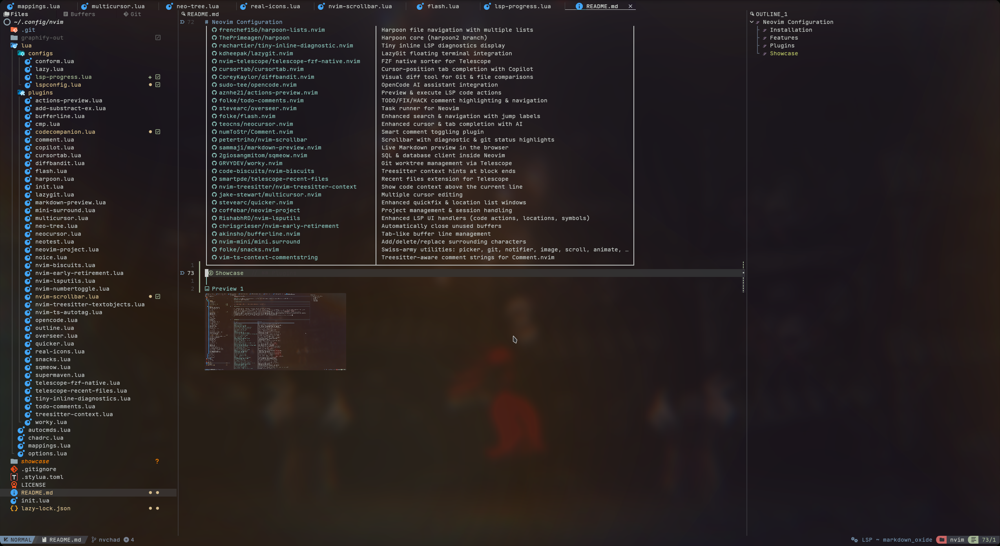
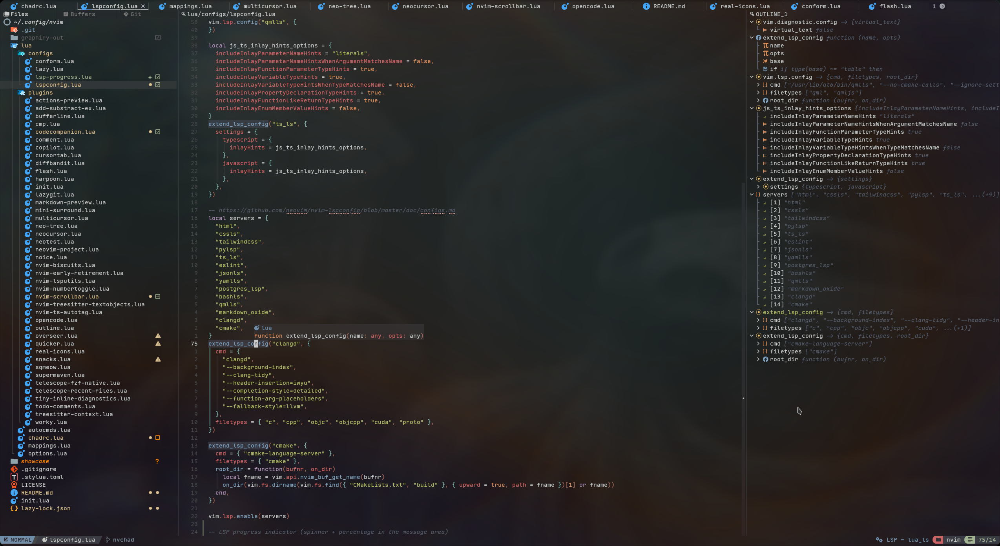
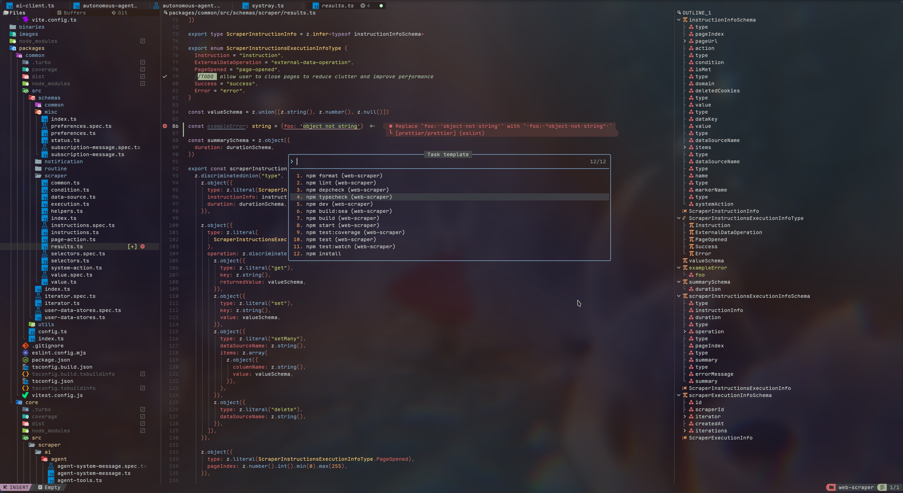

# Neovim Configuration

A [NvChad](https://github.com/NvChad/NvChad)-based Neovim configuration with the Tomorrow Night theme, transparency, and a focus on productivity, AI assistance, and smooth navigation.

## Installation

```
git clone https://github.com/Aktyn/neovim-config ~/.config/nvim
```

## Features

- **AI-assisted coding** — OpenCode, Neocursor, and inline completion support
- **Intelligent navigation** — Flash for jump-to characters, Harpoon for file lists, Telescope for fuzzy finding, and Treesitter-based text objects
- **File & project management** — Neo-tree explorer, project-aware sessions, LazyGit integration, and Git worktrees via Worky
- **Refactoring & editing** — Multi-cursor support, smart surround, real file icons, auto-closing pairs/tags, and enhanced code actions preview
- **LSP & diagnostics** — nvim-lspconfig with 15+ servers (incl. bacon-ls for live cargo/clippy diagnostics), inline diagnostics via Tiny Inline Diagnostic, and custom LSP handlers from nvim-lsputils
- **Code folding** — Treesitter-based folding via nvim-ufo, with peek-under-cursor on `K`
- **Rust tooling** — rustaceanvim for the LSP, crates.nvim for Cargo.toml editing, and conform's rustfmt/taplo integration
- **Testing & tasks** — Neotest for Vitest, Overseer task runner, and npm scripts execution
- **Productivity extras** — SQL client (Sqmeow), markdown preview, diff viewer (DiffBandit), and auto-closing idle buffers

---

## Plugins

| Plugin | Description |
|--------|-------------|
| [NvChad/NvChad](https://github.com/NvChad/NvChad) | Neovim distribution & UI framework (v2.5) |
| [stevearc/conform.nvim](https://github.com/stevearc/conform.nvim) | Formatter client supporting multiple formatters (incl. rustfmt, taplo) |
| [mrcjkb/rustaceanvim](https://github.com/mrcjkb/rustaceanvim) | Rust-analyzer integration & rust tooling |
| [saecki/crates.nvim](https://github.com/saecki/crates.nvim) | Cargo.toml dependency management |
| [neovim/nvim-lspconfig](https://github.com/neovim/nvim-lspconfig) | LSP client configuration with 15+ servers |
| [nvim-treesitter/nvim-treesitter](https://github.com/nvim-treesitter/nvim-treesitter) | Incremental parsing for syntax highlighting |
| [kevinhwang91/nvim-ufo](https://github.com/kevinhwang91/nvim-ufo) | Treesitter-based code folding with peek-under-cursor |
| [nvim-telescope/telescope.nvim](https://github.com/nvim-telescope/telescope.nvim) | Fuzzy file/dict/grep finder |
| [windwp/nvim-ts-autotag](https://github.com/windwp/nvim-ts-autotag) | Auto close and rename HTML/JSX tags |
| [altermo/ultimate-autopair.nvim](https://github.com/altermo/ultimate-autopair.nvim) | Treesitter-aware auto-pairing (quotes, brackets, parens) with multiline support |
| [hedyhli/outline.nvim](https://github.com/hedyhli/outline.nvim) | Code outline/sidebar via LSP symbols |
| [folke/noice.nvim](https://github.com/folke/noice.nvim) | Advanced UI for messages, cmdline & popups |
| [nvim-neo-tree/neo-tree.nvim](https://github.com/nvim-neo-tree/neo-tree.nvim) | File explorer tree |
| [nvim-treesitter/nvim-treesitter-textobjects](https://github.com/nvim-treesitter/nvim-treesitter-textobjects) | Treesitter-based text objects and navigation |
| [sitiom/nvim-numbertoggle](https://github.com/sitiom/nvim-numbertoggle) | Automatically toggle relative line numbers |
| [nvim-neotest/neotest](https://github.com/nvim-neotest/neotest) | Testing framework (Vitest adapter) |
| [Mirsmog/real-icons.nvim](https://github.com/Mirsmog/real-icons.nvim) | Real-file icons for file explorers & pickers |
| [DRoma82/add-subtract-ex.nvim](https://github.com/DRoma82/add-subtract-ex.nvim) | Increment/decrement numbers and dates |
| [hrsh7th/nvim-cmp](https://github.com/hrsh7th/nvim-cmp) | Autocompletion engine |
| [frenchef156/harpoon-lists.nvim](https://github.com/frenchef156/harpoon-lists.nvim) | Harpoon file navigation with multiple lists |
| [ThePrimeagen/harpoon](https://github.com/ThePrimeagen/harpoon) | Harpoon core (harpoon2 branch) |
| [rachartier/tiny-inline-diagnostic.nvim](https://github.com/rachartier/tiny-inline-diagnostic.nvim) | Tiny inline LSP diagnostics display |
| [kdheepak/lazygit.nvim](https://github.com/kdheepak/lazygit.nvim) | LazyGit floating terminal integration |
| [nvim-telescope/telescope-fzf-native.nvim](https://github.com/nvim-telescope/telescope-fzf-native.nvim) | FZF native sorter for Telescope |
| [cursortab/cursortab.nvim](https://github.com/cursortab/cursortab.nvim) | Cursor-position tab completion with Copilot |
| [CoreyKaylor/diffbandit.nvim](https://github.com/CoreyKaylor/diffbandit.nvim) | Visual diff tool for Git & file comparisons |
| [sudo-tee/opencode.nvim](https://github.com/sudo-tee/opencode.nvim) | OpenCode AI assistant integration |
| [aznhe21/actions-preview.nvim](https://github.com/aznhe21/actions-preview.nvim) | Preview & execute LSP code actions |
| [folke/todo-comments.nvim](https://github.com/folke/todo-comments.nvim) | TODO/FIX/HACK comment highlighting & navigation |
| [stevearc/overseer.nvim](https://github.com/stevearc/overseer.nvim) | Task runner for Neovim |
| [folke/flash.nvim](https://github.com/folke/flash.nvim) | Enhanced search & navigation with jump labels |
| [teocns/neocursor.nvim](https://github.com/teocns/neocursor.nvim) | Enhanced cursor & tab completion with AI |
| [numToStr/Comment.nvim](https://github.com/numToStr/Comment.nvim) | Smart comment toggling plugin |
| [petertriho/nvim-scrollbar](https://github.com/petertriho/nvim-scrollbar) | Scrollbar with diagnostic & git status highlights |
| [sammaji/markdown-preview.nvim](https://github.com/sammaji/markdown-preview.nvim) | Live Markdown preview in the browser |
| [2giosangmitom/sqmeow.nvim](https://github.com/2giosangmitom/sqmeow.nvim) | SQL & database client inside Neovim |
| [GRVYDEV/worky.nvim](https://github.com/GRVYDEV/worky.nvim) | Git worktree management via Telescope |
| [code-biscuits/nvim-biscuits](https://github.com/code-biscuits/nvim-biscuits) | Treesitter context hints at block ends |
| [smartpde/telescope-recent-files](https://github.com/smartpde/telescope-recent-files) | Recent files extension for Telescope |
| [nvim-treesitter/nvim-treesitter-context](https://github.com/nvim-treesitter/nvim-treesitter-context) | Show code context above the current line |
| [jake-stewart/multicursor.nvim](https://github.com/jake-stewart/multicursor.nvim) | Multiple cursor editing |
| [stevearc/quicker.nvim](https://github.com/stevearc/quicker.nvim) | Enhanced quickfix & location list windows |
| [coffebar/neovim-project](https://github.com/coffebar/neovim-project) | Project management & session handling |
| [RishabhRD/nvim-lsputils](https://github.com/RishabhRD/nvim-lsputils) | Enhanced LSP UI handlers (code actions, locations, symbols) |
| [chrisgrieser/nvim-early-retirement](https://github.com/chrisgrieser/nvim-early-retirement) | Automatically close unused buffers |
| [akinsho/bufferline.nvim](https://github.com/akinsho/bufferline.nvim) | Tab-like buffer line management |
| [nvim-mini/mini.surround](https://github.com/nvim-mini/mini.surround) | Add/delete/replace surrounding characters |
| [folke/snacks.nvim](https://github.com/folke/snacks.nvim) | Swiss-army utilities: picker, git, notifier, image, scroll, animate, … |
| [vim-ts-context-commentstring](https://github.com/JoosepAlviste/nvim-ts-context-commentstring) | Treesitter-aware comment strings for Comment.nvim |

## Showcase




